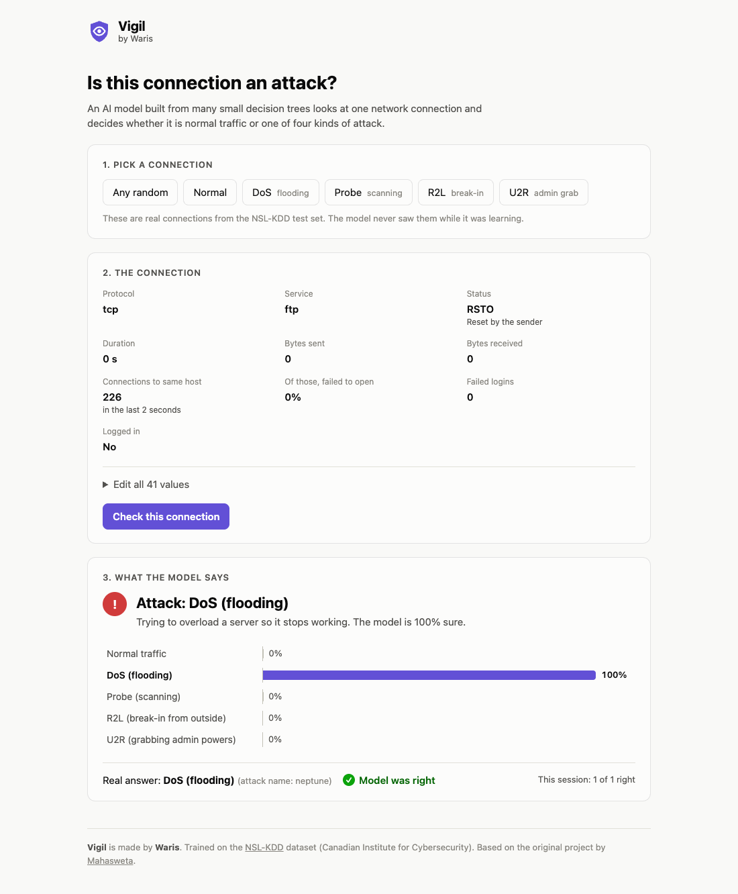

<p align="center">
  
</p>

<h1 align="center">Vigil</h1>
<p align="center"><b>Network threat detection, by Waris</b></p>

Vigil is a machine learning model that looks at one network connection and says whether it is
**normal traffic** or one of four kinds of attack:

| Type | Meaning |
|---|---|
| **normal** | Ordinary, harmless traffic |
| **dos** | Flooding a server so it stops working |
| **probe** | Scanning the network for open doors and weak spots |
| **r2l** | An outsider trying to break in, for example by guessing passwords |
| **u2r** | Someone already inside trying to become admin |

Each connection is described by 41 numbers and labels from the
[NSL-KDD](https://www.unb.ca/cic/datasets/nsl.html) dataset (bytes sent, service used,
connections in the last 2 seconds, failed logins, ...). It includes a Flask API and a
small web page for trying the model on real test connections.



## Quick start

You need [Python 3.13](https://www.python.org/downloads/) and Git.

```bash
git clone https://github.com/avinrique/cybersecurity-threat-ai.git
cd cybersecurity-threat-ai
./run.sh        # macOS / Linux
run.bat         # Windows
```

The first run installs everything (about a minute). Then the web page opens at
http://127.0.0.1:5077. Press `Ctrl+C` in the terminal to stop it. The trained model is
already included, so there is no training step.

---

## Accuracy

Measured on `KDDTest+` (22,544 connections the model never saw while training; about 1 in 6
of them are attack types that do not appear in the training data at all):

| Model | Accuracy | dos caught | probe caught | r2l caught | u2r caught | False alarms on normal traffic |
|---|---|---|---|---|---|---|
| Original random forest | 75.5% | 80% | 63% | 1% | 7% | 2.6% |
| **Gradient boosting (current)** | **82.5%** | 85% | 80% | 29% | 46% | 3.0% |

The current model is a `HistGradientBoostingClassifier` with shallow trees (`max_depth=3`),
`l2_regularization=1.0` and balanced class weights, with `protocol_type`, `service` and `flag`
treated as categories. Shallow trees generalize better to unseen attack types, and balanced
weights stop the rare r2l/u2r attacks from being ignored. Settings were chosen on one half of
`KDDTest+`; the other half was held back and gave 82.4%.

**Limits:** it is a learning project, not a production intrusion detection system. It does not
read live network traffic; you have to supply the 41 features. It still misses most r2l
break-ins, many of which look identical to normal traffic in these features.

---

## Project Structure
```
cybersecurity-threat-ai/
├── data/
│   ├── KDDTrain+.txt        # NSL-KDD training connections
│   ├── KDDTest+.txt         # NSL-KDD test connections
│   └── ...                  # Other NSL-KDD files (ARFF versions, 20% subset, hard subset)
├── models/
│   └── threat_detector.pkl  # Trained model
├── src/
│   ├── nsl_kdd.py           # Feature names, attack types, data loading
│   ├── train.py             # Trains and saves the model, prints test accuracy
│   ├── predict.py           # Predicts on KDDTest+ and prints accuracy
│   ├── deploy.py            # Flask API and web page
│   ├── templates/index.html # Web page
│   ├── static/logo.svg      # Vigil logo (also the favicon)
│   └── preprocess.py        # Old ARFF -> CSV step (no longer needed)
├── docs/screenshot.png      # Web page screenshot for this README
├── notebooks/               # Exploration notebook
├── run.sh / run.bat         # One-command start (macOS, Linux / Windows)
└── requirements.txt
```

---

## Setup
```bash
python3 -m venv venv
source venv/bin/activate          # Windows: venv\Scripts\activate
pip install -r requirements.txt
```

Run all commands from the project root.

## Usage

### Train the model
```bash
python src/train.py
```
Takes a few seconds and prints the accuracy on `KDDTest+`.

### Test it locally
```bash
python src/predict.py
```

### Run the API and web page
```bash
python src/deploy.py
```
Open http://127.0.0.1:5000. On macOS, port 5000 is used by AirPlay, so pick another port:
```bash
PORT=5077 python src/deploy.py
```

### Send a request
`protocol_type`, `service` and `flag` are sent as text. All 41 features are required.
```bash
curl -X POST http://127.0.0.1:5000/predict \
  -H "Content-Type: application/json" \
  -d '{"duration": 0, "protocol_type": "tcp", "service": "http", "flag": "SF", "src_bytes": 232, "dst_bytes": 8153, ...}'
```

Response:
```json
{
  "prediction": ["normal"],
  "confidence": [0.99],
  "probabilities": [{"dos": 0.0, "normal": 0.99, "probe": 0.0, "r2l": 0.0, "u2r": 0.0}]
}
```
Send a list of objects to check several connections at once. Unknown text values return an
error such as `{"error": "Unknown service 'zoom'"}`.

---

## Author
Vigil is built by **Waris**.

## Credits & License
Based on the original project by Mahasweta
([mahaswetaroy1/cybersecurity-threat-ai](https://github.com/mahaswetaroy1/cybersecurity-threat-ai)).
Dataset: NSL-KDD, Canadian Institute for Cybersecurity.
Licensed under the MIT License; see `LICENSE`.

